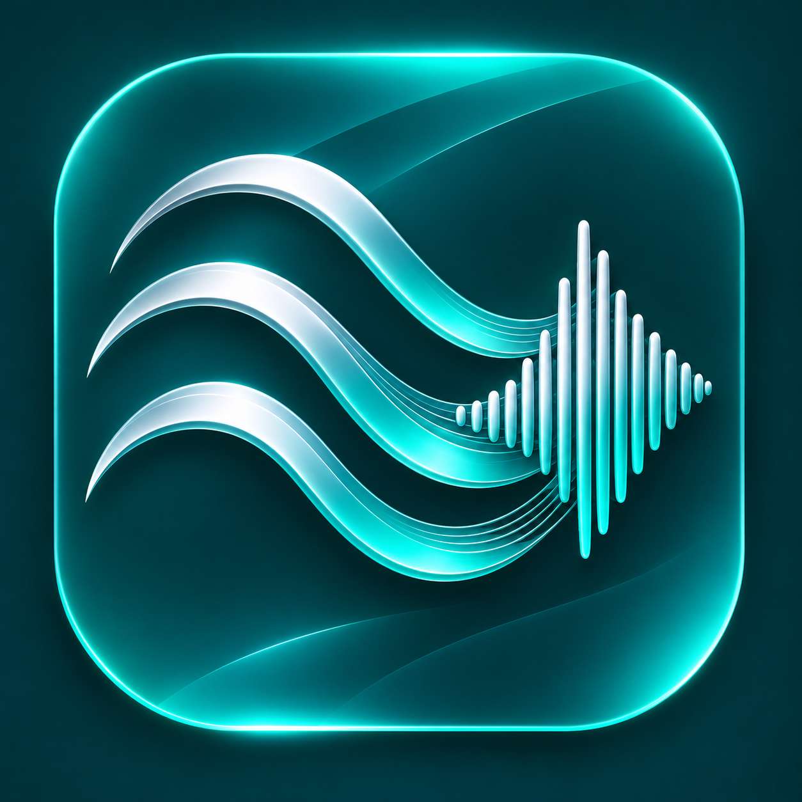
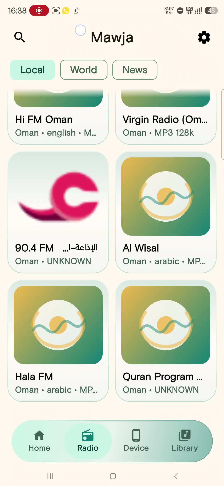
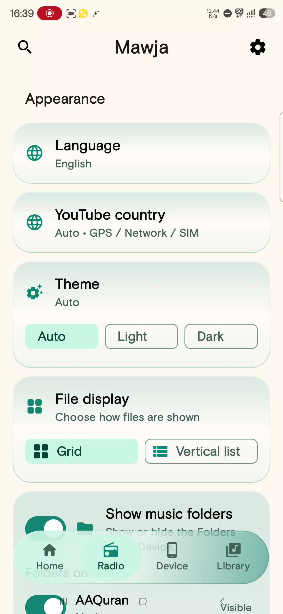
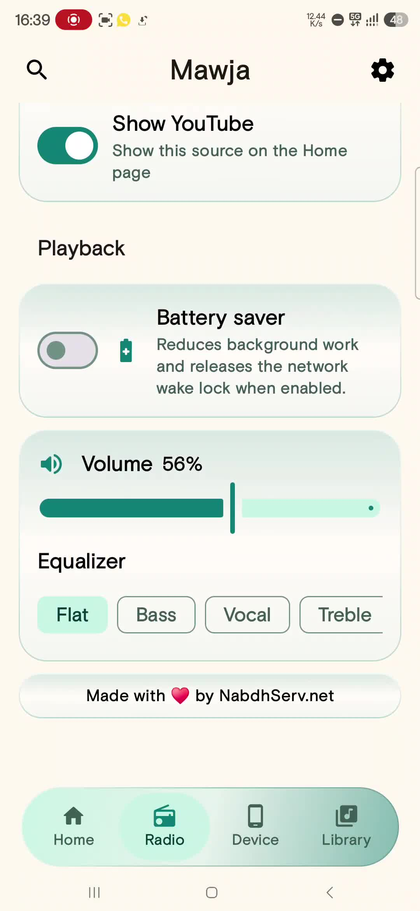

  

<h1 align="center">Mawja · موجة</h1>

موسيقاك بطريقتك · Your music, your way

  <a href="#العربية">العربية</a> ·
  <a href="#english">English</a> ·
  <a href="doc/ROADMAP.md">خطة الإصدارات · Roadmap</a> ·
  <a href="https://github.com/alrasby/Mawja/actions/workflows/build.yml">التنزيلات والبناء · Builds</a>

## العربية

موجة مشغّل وسائط لأندرويد يجمع مكتبة الموسيقى والفيديو على جهازك، ومحطات الراديو عبر الإنترنت، ومحتوى YouTube وAudius في مكان واحد. واجهته تجمع عناصر Material 3 مع بطاقات ولمسات زجاجية مستوحاة من Siri Glass، وتدعم العربية واتجاه القراءة من اليمين إلى اليسار.

### المميزات

- **مكتبة الجهاز** — تصفّح الموسيقى والفيديوهات حسب المجلدات والألبومات والفنانين، مع تبويبات الكل والموسيقى والفيديو.
- **راديو الإنترنت** — محطات محلية وعالمية وأخبار، مع اختيار الدولة وإضافة محطة برابط بث.
- **البحث الموحّد** — افتح البحث من الأيقونة واختر الجهاز أو الراديو أو YouTube أو Audius.
- **مكتبتي** — المفضلة والمحطات المضافة وسجل التشغيل الأخير.
- **التحكم بالتشغيل** — تقديم وتأخير للملفات القابلة للتنقل، وتكرار وخلط ومؤقت نوم.
- **تخصيص الصوت** — إعدادات المعادل Flat وBass وVocal وTreble، مع التحكم في مستوى الصوت.
- **المظهر** — الوضع الفاتح والداكن والتلقائي، والعرض الشبكي أو القوائم، وإظهار المجلدات وإخفاؤها.
- **Android Auto** — تصفّح مكتبتك وتشغيل الصوتيات ومحطات الراديو من شاشة السيارة، مع تشغيل المسار الصوتي للفيديو المحلي.
- **إعدادات مباشرة** — تطبيق إعدادات المعادل وموفّر البطارية أثناء التشغيل.

### صور من التطبيق

لقطات فعلية من تسجيلات تجربة التطبيق. قد تختلف بعض تفاصيل الواجهة بين الإصدارات.

<table>
  <tr>
    <th>الراديو · Radio</th>
    <th>المظهر · Appearance</th>
    <th>الصوت · Playback</th>
  </tr>
  <tr>
    <td></td>
    <td></td>
    <td></td>
  </tr>
</table>

### الاستخدام والتنزيل

يتطلب موجة أندرويد 8.0 أو أحدث. يتطلب راديو الإنترنت والمصادر الإلكترونية اتصالًا بالإنترنت، وتعتمد إتاحة المحتوى على المصدر والمنطقة. يتطلب الوصول إلى ملفات الجهاز منح أذونات الوسائط المناسبة.

افتح تشغيل البناء الناجح في GitHub Actions ثم نزّل الملف من Artifacts وفك ضغطه. ملف APK مخصص للتثبيت، وملف AAB مخصص للرفع إلى Google Play Console. تنزيل ملفات البناء قد يتطلب تسجيل الدخول إلى GitHub.

دعم السيارة الحالي يشغّل الصوت عبر Android Auto. البحث الموثّق بالتردد ونوع الموجة مدرج ضمن خطة إصدار ميزات قادم.

[البناء والتنزيلات](https://github.com/alrasby/Mawja/actions/workflows/build.yml) · [خطة الإصدارات](doc/ROADMAP.md) · [الإبلاغ عن مشكلة](https://github.com/alrasby/Mawja/issues)

## English

Mawja is an Android media player that brings your local music and videos, internet radio, YouTube, and Audius together. Its interface combines Material 3 components with Siri Glass-inspired cards and translucent accents, with Arabic and right-to-left layout support.

### Features

- **Device library** — Browse local music and videos by folder, album, or artist, with All, Music, and Videos filters.
- **Internet radio** — Explore local, worldwide, and news stations, select a country, or add a station using its stream URL.
- **Unified search** — Search your device, radio stations, YouTube, or Audius from the search icon.
- **My Library** — Keep favorites, custom stations, and recently played media together.
- **Playback controls** — Seek within supported files, shuffle, repeat, and use a sleep timer.
- **Sound settings** — Choose Flat, Bass, Vocal, or Treble equalizer presets and adjust playback volume.
- **Appearance** — Light, dark, and system themes; grid and list layouts; folder visibility controls.
- **Android Auto** — Browse your library and play audio or radio from the car display, including the audio track of local video files.
- **Live preferences** — Apply equalizer and battery saver settings during playback.

### Screenshots

The gallery above contains actual captures from app testing. Some interface details may vary between versions.

### Requirements and downloads

Mawja requires Android 8.0 or later. Internet radio and online sources require a network connection, and content availability depends on the provider and region. Local media access requires the relevant device permissions.

Open a successful GitHub Actions run, download its artifact, and extract the ZIP. Use the APK for installation and the AAB for Google Play Console uploads. GitHub may require you to sign in to download build artifacts.

Current car support provides audio playback through Android Auto. Verified frequency and radio-band search is planned for a future feature release.

[Builds and downloads](https://github.com/alrasby/Mawja/actions/workflows/build.yml) · [Release roadmap](doc/ROADMAP.md) · [Report an issue](https://github.com/alrasby/Mawja/issues)

---

Made with ♥ By <a href="https://nabdhserv.net">NabdhServ.Net</a>

